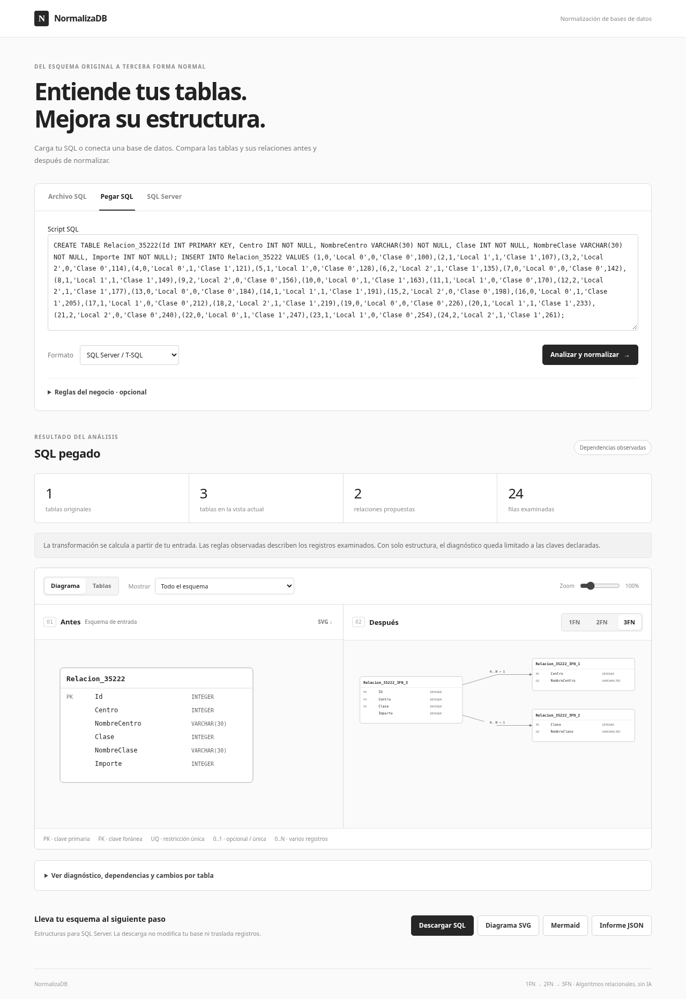

# NormalizaDB

Aplicación web de normalización relacional, sin IA. Recibe un archivo SQL o una conexión SQL Server, interpreta su estructura, descubre dependencias en los registros disponibles y calcula las etapas 1FN, 2FN y 3FN. Muestra **antes y después**, en tablas o diagramas con relaciones y cardinalidades, con una interfaz en grises.



El motor no contiene nombres de tablas, dependencias ni resultados preparados para ejemplos. SQLGlot interpreta la entrada, el motor relacional calcula la transformación y Dagre distribuye los diagramas. El directorio `examples/` contiene entradas opcionales; ninguna se carga automáticamente.

## Ejecutar la aplicación

Requiere Node.js 24.15+ de la rama 24, npm y Python 3.10+.

```sh
npm ci
npm run setup:sql
npm run dev
```

Abre **http://localhost:4200**. Angular redirige `/api` a Express en `127.0.0.1:3001`. El flujo de archivos funciona sin instalar ni conectar SQL Server. `SQLGLOT_PYTHON` puede apuntar a otro Python que tenga las dependencias de `python/requirements.txt`.

En Windows, crea el entorno con `py -m venv .venv` e instala las dependencias con `.venv\Scripts\python -m pip install -r python/requirements.txt`. La API detecta ese ejecutable.

## Qué significa automático

1. Cargar SQL o conectar SQL Server inicia el análisis de todas las tablas.
2. PRIMARY KEY y UNIQUE NOT NULL aportan dependencias del esquema.
3. Los INSERT literales o registros leídos desde SQL Server permiten descubrir dependencias por comparación de particiones de valores. No se infieren reglas por nombres como Cliente o Producto. Los determinantes deben repetirse y presentar al menos dos valores diferentes; se excluyen constantes y atributos con NULL.
4. Se calculan todas las claves candidatas, dependencias parciales y violaciones de 3FN. La 2FN usa descomposición binaria y la 3FN síntesis de cubierta mínima con inclusión de una clave.
5. Las tres etapas, sus advertencias, claves, referencias y descargas quedan disponibles. Si una etapa no puede conservar una restricción, queda bloqueada con un motivo y las demás siguen visibles.

**Ningún programa puede deducir todas las reglas del negocio desde cualquier DDL o muestra finita.** Con solo DDL, la forma normal está condicionada a las claves declaradas. Con registros, las dependencias descubiertas son hipótesis sobre esos registros. El diagnóstico muestra esa procedencia y no certifica filas futuras.

Si se conocen dependencias adicionales, pueden incluirse como comentarios `-- @fd MiTabla: A -> B` o cargarse mediante un JSON `{ "MiTabla": "A -> B\nB -> C" }`. Son entradas del usuario, no reglas incrustadas en la aplicación. Se validan las columnas y se contrastan las reglas con los registros examinados. Las reglas declaradas prevalecen sobre las hipótesis observadas. Para el archivo universitario existente se puede cargar su JSON complementario desde la interfaz.

## Entrada y conservación del esquema

- UTF-8 y UTF-16 con BOM; hasta 50 MiB, 1000 tablas y 256 columnas por tabla.
- Dialectos de lectura seleccionables: SQL Server, PostgreSQL, MySQL y SQLite. La salida es SQL Server. El soporte depende de los nodos que SQLGlot pueda representar; no equivale a ejecutar todos los dialectos ni todo T-SQL.
- CREATE TABLE, claves inline o de tabla, PRIMARY KEY CLUSTERED/NONCLUSTERED, UNIQUE, FK, ALTER ADD, índices únicos no filtrados, GO aislado, USE y SET.
- Conserva IDENTITY, DEFAULT, COLLATE, CHECK y expresiones calculadas cuando sus columnas permanecen juntas. Conserva UNIQUE nullable aunque no sea una clave candidata relacional. Las opciones físicas de almacenamiento, índices no únicos/filtrados, procedimientos y triggers no se reproducen como parte del esquema normalizado.
- INSERT VALUES se interpreta sin ejecutarse. Admite literales, NULL, conversiones de literales e identidades implícitas. INSERT SELECT y expresiones que requieren ejecución se omiten del perfil con advertencia. No se ejecuta el SQL recibido.
- Los perfiles examinan hasta 10 000 registros por tabla. Se señala el muestreo; la búsqueda usa determinantes de hasta tres atributos, un presupuesto de 10 000 combinaciones y ocho segundos por perfil. La búsqueda relacional exacta tiene un presupuesto de 25 000 combinaciones. Alcanzar un límite se comunica y no equivale a demostrar ausencia de dependencias.
- Sin clave declarada se propone una columna técnica BIGINT IDENTITY con nombre libre. No se inventa una clave de negocio a partir de valores accidentalmente únicos.
- Los grupos numerados se proponen como tablas hijas con posición. Los grupos con los mismos índices se mantienen juntos (por ejemplo Producto1/Cantidad1 y Producto2/Cantidad2). Es una hipótesis de estructura explícita, no una deducción de semántica. Los grupos que participan en restricciones que no pueden trasladarse se conservan con advertencia.
- Una coma, un punto y coma o una barra en texto no provoca una división automática ni bloquea la tabla. Esos valores se conservan escalares. Listas o relaciones anidadas cuya semántica no esté descrita necesitan definirse antes de descomponerlas.
- Si los datos contienen NULL en una columna que tendría que convertirse en clave, se bloquea esa etapa. No se eliminan filas, no se ocultan los NULL ni se asegura una reconstrucción sin pérdida que esos datos no permitan.

## Conectar SQL Server

La pestaña **SQL Server** permite usar la conexión configurada en el servidor o escribir servidor, puerto, base, usuario y contraseña para una lectura. Las credenciales no se guardan en el navegador ni en el informe. El servidor ejecuta consultas de catálogo y SELECT, nunca cambios sobre la base conectada.

Para una instancia existente, configura `.env` a partir de `.env.example` o completa el formulario. Se requiere acceso al servidor, autenticación SQL, permisos de metadatos (VIEW DEFINITION) y SELECT para analizar registros. Si solo se pueden leer metadatos, se avisa y el diagnóstico queda limitado al esquema. TLS permanece activado y se valida el certificado. `DB_CA_FILE` permite confiar en una CA privada desde el servidor; no se acepta una ruta de certificado enviada por el navegador.

Para preparar una **instancia local vacía** necesitas Docker con Compose y OpenSSL:

```sh
npm run db:local
npm run dev:local
```

El primer comando descarga SQL Server 2022 Developer, genera una contraseña aleatoria y certificados locales, inicia la base `NormalizaDB` en `localhost:14333` y escribe `.env.sqlserver.local`. El segundo inicia la aplicación con esa conexión. Se acepta la licencia Developer del contenedor, destinada a desarrollo. No se precargan tablas ni ejemplos. Puedes cargar tu base con SSMS y elegir la conexión del servidor en la aplicación.

Las claves y certificados quedan en `.local/`, los datos en un volumen Docker y los archivos de entorno fuera de Git. El puerto solo se publica en loopback. Una red que bloquee Microsoft Container Registry impedirá descargar SQL Server; en ese caso utiliza una instancia existente o ejecuta la preparación en una máquina con acceso al registro.

## Comparar y descargar

La vista izquierda conserva la entrada; la derecha cambia entre 1FN/2FN/3FN. Hay vista de tablas, diagramas con zoom, filtro por tabla original, diagnóstico por tabla y SVG del esquema original. Los diagramas distinguen PK, FK, UQ, uno a uno, uno a muchos y participación opcional.

Se descargan estructuras SQL Server, SVG, Mermaid y un informe JSON. **No se migran registros ni se aplican cambios a la base conectada.** Una FK sin destino inequívoco, una restricción imposible de trasladar o una clave incompatible impiden exportar esa etapa.

## Verificar el proyecto

```sh
npm run test:sql
npm run test:engine
npm test -- --watch=false
npm run typecheck:api
npm run build
npm run format:check
npx playwright install chromium
npm run test:e2e
```

Puede indicarse `PLAYWRIGHT_CHROMIUM_PATH` para usar Chromium del sistema. El lector manual anterior se conserva para regresiones; la aplicación utiliza SQLGlot. La disponibilidad de SQL Server real debe comprobarse en la instalación donde se ejecutará; los recorridos del navegador no sustituyen esa conexión.
